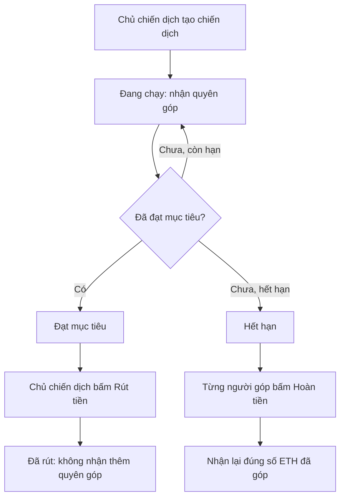
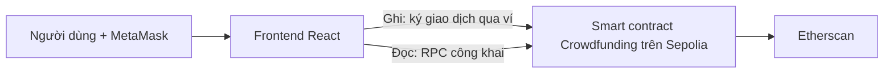

# Tu_Thien_Minh_Bach
Blockchain University Project

Nền tảng **gây quỹ từ thiện minh bạch trên blockchain**. Mọi khoản quyên góp, rút tiền và hoàn tiền đều được thực hiện bởi smart contract và ghi công khai trên mạng thử nghiệm **Ethereum Sepolia**, ai cũng có thể kiểm chứng trên Etherscan.

> Đồ án môn Blockchain. Dự án chạy trên **testnet**, dùng ETH thử nghiệm, không dùng tiền thật.

---

## Mục lục

1. [Giới thiệu](#1-giới-thiệu)
2. [Thông tin triển khai](#2-thông-tin-triển-khai)
3. [Các chức năng](#3-các-chức-năng)
4. [Luồng hoạt động từ đầu đến cuối](#4-luồng-hoạt-động-từ-đầu-đến-cuối)
5. [Kiến trúc và công nghệ](#5-kiến-trúc-và-công-nghệ)
6. [Cấu trúc thư mục](#6-cấu-trúc-thư-mục)
7. [Hướng dẫn cài đặt và chạy](#7-hướng-dẫn-cài-đặt-và-chạy)
8. [Smart contract](#8-smart-contract)
9. [Hướng dẫn demo nhanh](#9-hướng-dẫn-demo-nhanh)
10. [Xử lý lỗi thường gặp](#10-xử-lý-lỗi-thường-gặp)
11. [Hạn chế đã biết](#11-hạn-chế-đã-biết)
12. [Quy trình làm việc nhóm](#12-quy-trình-làm-việc-nhóm)
13. [Thành viên](#13-thành-viên)

---

## 1. Giới thiệu

Gây quỹ từ thiện truyền thống thường bị hỏi: tiền đi đâu, có đến đúng người không. Dự án giải quyết bằng blockchain:

- **Minh bạch:** mỗi lượt quyên góp là một giao dịch công khai, có mã giao dịch (tx hash) và liên kết Etherscan.
- **Không cần tin trung gian:** tiền nằm trong smart contract, chỉ di chuyển theo luật lập trình sẵn.
- **Bảo vệ người góp:** nếu chiến dịch hết hạn mà chưa đạt mục tiêu, người góp tự nhận lại tiền của mình.
- **Bảo vệ người nhận:** chỉ chủ chiến dịch rút được tiền, và chỉ khi đã đạt mục tiêu.

## 2. Thông tin triển khai

| Mục | Giá trị |
|---|---|
| Mạng | Ethereum **Sepolia** (chainId `11155111`) |
| Địa chỉ contract | `0x61958A66c61566BbEec28feEE3acf933776244f3` |
| Xem trên Etherscan | https://sepolia.etherscan.io/address/0x61958A66c61566BbEec28feEE3acf933776244f3 |
| Block deploy | `12160571` |
| Solidity | `0.8.34` |

Nguồn duy nhất của thông tin này ở phía giao diện là file `frontend/src/contracts/config.js`. Khi deploy lại contract, chỉ cần sửa file đó.

## 3. Các chức năng

### 3.1 Với người dùng (giao diện web)

| Chức năng | Mô tả | Trang |
|---|---|---|
| Kết nối ví | Kết nối MetaMask, tự động yêu cầu chuyển sang mạng Sepolia, tự cập nhật khi đổi tài khoản hoặc đổi mạng | Thanh điều hướng |
| Xem danh sách chiến dịch | Đọc trực tiếp từ blockchain, hiển thị thẻ chiến dịch kèm tiến độ và trạng thái | `/campaigns` |
| Xem chi tiết chiến dịch | Ảnh, tiêu đề, người tạo, mục tiêu, số tiền đã gom, thanh tiến độ, đồng hồ đếm ngược, mô tả | `/campaigns/:id` |
| Tạo chiến dịch | Nhập tiêu đề, mô tả, ảnh (đường dẫn), mục tiêu (ETH), số ngày diễn ra | `/create` |
| Quyên góp | Nhập số ETH và xác nhận trong MetaMask | Trang chi tiết, thẻ chiến dịch |
| Rút tiền | Chủ chiến dịch rút toàn bộ số tiền khi đã đạt mục tiêu | Trang chi tiết |
| Hoàn tiền | Người đã góp nhận lại tiền khi chiến dịch hết hạn mà chưa đạt mục tiêu | Trang chi tiết |
| Lịch sử quyên góp | Danh sách các lượt góp, đọc từ event trên blockchain | Trang chi tiết |
| Chiến dịch của tôi | Lọc các chiến dịch do ví đang kết nối tạo | `/my-campaigns` |
| Liên kết Etherscan | Sau mỗi giao dịch có đường dẫn để tự kiểm chứng | Thông báo giao dịch |
| Thông báo lỗi tiếng Việt | Dịch lỗi của MetaMask và contract sang tiếng Việt dễ hiểu | Toàn bộ ứng dụng |

**Trạng thái chiến dịch** hiển thị trên giao diện:

| Trạng thái | Điều kiện |
|---|---|
| Đang chạy | Còn hạn và chưa đạt mục tiêu |
| Đạt mục tiêu | Số tiền gom được lớn hơn hoặc bằng mục tiêu, chưa rút |
| Hết hạn | Quá hạn và chưa đạt mục tiêu |
| Đã rút | Chủ chiến dịch đã rút tiền |

**Quy tắc hiển thị nút:**

- Nút **Rút tiền** chỉ hiện cho chủ chiến dịch, khi đã đạt mục tiêu và chưa rút.
- Nút **Hoàn tiền** chỉ hiện khi chiến dịch đã hết hạn, chưa đạt mục tiêu, và ví đang kết nối đã từng góp.
- Form quyên góp ẩn khi chiến dịch đã hết hạn hoặc đã rút tiền.

### 3.2 Với smart contract

| Hàm | Ai gọi | Điều kiện |
|---|---|---|
| `createCampaign` | Bất kỳ ai | Tiêu đề không rỗng, mục tiêu lớn hơn 0, thời hạn từ 1 ngày trở lên |
| `donate` | Bất kỳ ai | Chiến dịch còn hạn, chưa rút tiền, số ETH gửi lớn hơn 0 |
| `withdraw` | Chỉ chủ chiến dịch | Đã đạt mục tiêu, chưa rút trước đó |
| `refund` | Người đã góp | Đã hết hạn, chưa đạt mục tiêu, có tiền đã góp |
| `getCampaign`, `getCampaignCount`, `donations` | Bất kỳ ai | Hàm chỉ đọc |

## 4. Luồng hoạt động từ đầu đến cuối

### 4.1 Vòng đời một chiến dịch



### 4.2 Từng bước chi tiết

**Bước 1. Chuẩn bị ví.** Người dùng cài MetaMask, chuyển sang mạng Sepolia và nhận ETH thử nghiệm từ faucet.

**Bước 2. Kết nối.** Mở web, bấm kết nối ví. Nếu đang ở sai mạng, ứng dụng tự yêu cầu chuyển sang Sepolia.

**Bước 3. Tạo chiến dịch.** Vào trang tạo chiến dịch, nhập thông tin và xác nhận giao dịch trong MetaMask. Contract ghi chiến dịch mới và phát sự kiện `CampaignCreated`. Hạn chót được tính bằng thời điểm của block cộng số ngày đã chọn.

**Bước 4. Quyên góp.** Người góp mở chiến dịch, nhập số ETH và xác nhận. Contract cộng vào `amountRaised`, ghi nhận riêng số tiền của từng người góp (để hoàn tiền sau này) và phát sự kiện `DonationReceived`. Giao diện hiện liên kết Etherscan của giao dịch.

**Bước 5a. Nếu đạt mục tiêu.** Chủ chiến dịch thấy nút **Rút tiền**. Contract đánh dấu `withdrawn = true` trước, rồi mới chuyển toàn bộ số tiền về ví chủ chiến dịch (phát sự kiện `FundsWithdrawn`). Từ lúc này chiến dịch đóng, không nhận thêm quyên góp.

**Bước 5b. Nếu hết hạn mà chưa đạt mục tiêu.** Mỗi người góp thấy nút **Hoàn tiền**. Contract đặt số dư của người đó về 0 trước, rồi chuyển lại đúng số ETH họ đã góp (phát sự kiện `Refunded`). Chủ chiến dịch không thể rút trong trường hợp này.

**Bước 6. Kiểm chứng.** Bất kỳ ai cũng có thể mở Etherscan để xem toàn bộ giao dịch của contract, hoặc xem **Lịch sử quyên góp** ngay trên trang chi tiết.

## 5. Kiến trúc và công nghệ



| Phần | Công nghệ |
|---|---|
| Smart contract | Solidity 0.8.34, OpenZeppelin (`ReentrancyGuard`) |
| Công cụ contract | Hardhat 3, Hardhat Ignition (deploy), Mocha + Chai + ethers (test) |
| Giao diện | React 19, Vite, React Router 7 |
| Kết nối blockchain | ethers v6 (`BrowserProvider` cho ví, `JsonRpcProvider` để đọc) |
| Ví | MetaMask |

**Phân tầng phía giao diện:** các component chỉ gọi hook trong `src/web3/hooks`, không gọi ethers trực tiếp. Chi tiết xem [`frontend/src/web3/README.md`](frontend/src/web3/README.md).

## 6. Cấu trúc thư mục

```
Tu_Thien_Minh_Bach/
├── contracts/                      # Smart contract và công cụ Hardhat
│   ├── contracts/Crowdfunding.sol  # Hợp đồng chính
│   ├── test/Crowdfunding.ts        # Bộ kiểm thử
│   ├── ignition/modules/           # Cấu hình deploy
│   ├── ignition/deployments/       # Lịch sử deploy (địa chỉ, ABI)
│   ├── scripts/seed.ts             # Tạo chiến dịch mẫu trên Sepolia
│   ├── abi/Crowdfunding.json       # ABI xuất ra
│   └── hardhat.config.ts
├── frontend/                       # Ứng dụng web
│   └── src/
│       ├── components/             # Navbar, CampaignCard, CampaignDetail, CreateCampaign,
│       │                           # DonateForm, WithdrawRefundButtons, DonationHistory, ...
│       ├── pages/MyCampaigns.jsx
│       ├── web3/                   # Toàn bộ phần kết nối blockchain
│       │   ├── hooks/              # useWallet, useCampaigns, useDonate, useWithdraw,
│       │   │                       # useRefund, useCreateCampaign, useDonations
│       │   ├── wallet.js, campaigns.js, donations.js, transactions.js
│       │   └── errors.js           # Dịch lỗi sang tiếng Việt
│       ├── contracts/              # config.js (địa chỉ) và abi.js
│       └── utils/campaignStatus.js # Tính trạng thái chiến dịch
└── README.md
```

## 7. Hướng dẫn cài đặt và chạy

### 7.1 Yêu cầu

- **Node.js 22 trở lên** (Hardhat 3 yêu cầu) và npm
- **Git**
- Trình duyệt có tiện ích **MetaMask**
- Một ví có **ETH Sepolia** để thử giao dịch. Nhận miễn phí từ các faucet Sepolia (ví dụ: Google Cloud Web3 faucet, Alchemy faucet)

### 7.2 Lấy mã nguồn

```bash
git clone https://github.com/nndhuycntt2311066-create/Tu_Thien_Minh_Bach.git
cd Tu_Thien_Minh_Bach
git checkout main
```

### 7.3 Chạy giao diện (cách nhanh nhất, dùng contract đã deploy sẵn)

```bash
cd frontend
npm install
npm run dev
```

Mở địa chỉ hiển thị trong terminal (mặc định `http://localhost:5173`). Giao diện đã trỏ sẵn tới contract trên Sepolia, **không cần cấu hình thêm**.

Lệnh khác:

```bash
npm run build     # build bản production vào thư mục dist
npm run preview   # chạy thử bản build
npm run lint      # kiểm tra code bằng oxlint
```

### 7.4 Cấu hình MetaMask

1. Cài MetaMask và tạo hoặc nhập ví.
2. Bật hiển thị mạng thử nghiệm và chọn **Sepolia**. Nếu quên, ứng dụng sẽ tự yêu cầu chuyển mạng khi bấm kết nối.
3. Nhận ETH Sepolia từ faucet vào ví.
4. Để thử đủ các luồng (đặc biệt là hoàn tiền), nên chuẩn bị **2 tài khoản** trong MetaMask.

### 7.5 Chạy kiểm thử smart contract

```bash
cd contracts
npm install
npx hardhat test
```

Test chạy trên mạng mô phỏng cục bộ, **không cần ví hay ETH**. Cần kết nối Internet lần đầu để Hardhat tải trình biên dịch Solidity.

Bộ kiểm thử gồm 16 trường hợp:

| Nhóm | Nội dung kiểm tra |
|---|---|
| `createCampaign` | Tạo thành công và phát event; từ chối mục tiêu bằng 0; từ chối tiêu đề rỗng |
| `donate` | Nhận góp và ghi đúng số tiền; từ chối 0 ETH; từ chối khi hết hạn; từ chối chiến dịch không tồn tại; từ chối góp sau khi đã rút |
| `withdraw` | Chủ rút được khi đạt mục tiêu; chưa đạt thì không rút được; người lạ không rút được; không rút 2 lần |
| `refund` | Hoàn tiền khi hết hạn mà chưa đạt; không hoàn khi còn hạn; không hoàn khi đã đạt mục tiêu; không hoàn 2 lần |

### 7.6 Tự deploy contract của riêng bạn (không bắt buộc)

Chỉ cần khi muốn triển khai một bản contract mới.

**Bước 1. Thiết lập biến cấu hình.** `hardhat.config.ts` đọc 3 biến sau. Đặt bằng biến môi trường hoặc `hardhat-keystore`:

| Biến | Ý nghĩa |
|---|---|
| `SEPOLIA_RPC_URL` | Đường dẫn RPC Sepolia (lấy từ Alchemy, Infura, hoặc dịch vụ tương tự) |
| `SEPOLIA_PRIVATE_KEY` | Khóa riêng của ví dùng để deploy (**chỉ dùng ví thử nghiệm**) |
| `ETHERSCAN_API_KEY` | Khóa API Etherscan, dùng để xác minh contract |

```bash
cd contracts
npx hardhat keystore set SEPOLIA_RPC_URL
npx hardhat keystore set SEPOLIA_PRIVATE_KEY
npx hardhat keystore set ETHERSCAN_API_KEY
```

> **Cảnh báo bảo mật:** tuyệt đối không commit khóa riêng hoặc file `.env` lên GitHub. Repo đã chặn `.env` trong `.gitignore`.

**Bước 2. Deploy.**

```bash
npx hardhat ignition deploy --network sepolia ignition/modules/Crowdfunding.ts
```

Lệnh in ra địa chỉ contract mới và lưu vào `ignition/deployments/`.

**Bước 3. Xác minh mã nguồn trên Etherscan** (để mọi người đọc được code):

```bash
npx hardhat verify --network sepolia <DIA_CHI_CONTRACT>
```

**Bước 4. Cập nhật giao diện.** Mở `frontend/src/contracts/config.js` và sửa:

- `CONTRACT_ADDRESS`: địa chỉ contract mới
- `DEPLOY_BLOCK`: số block lúc deploy (xem trên Etherscan), giúp đọc lịch sử nhanh hơn

Sửa tiếp hằng `CONTRACT_ADDRESS` trong `contracts/scripts/seed.ts` nếu dùng script tạo dữ liệu mẫu.

### 7.7 Tạo dữ liệu mẫu

Script `seed.ts` tạo sẵn 3 chiến dịch và vài khoản góp nhỏ để giao diện có dữ liệu demo:

```bash
cd contracts
npx hardhat run scripts/seed.ts --network sepolia
```

| Chiến dịch mẫu | Mục tiêu | Hạn | Dùng để demo |
|---|---|---|---|
| Chiến dịch demo hoàn tiền | 1 ETH | 1 ngày | Hoàn tiền (góp 0,002 ETH, không đạt mục tiêu, chờ hết hạn) |
| Xây thư viện cho trẻ em vùng cao | 0,001 ETH | 30 ngày | Rút tiền (đã góp đủ mục tiêu) |
| Quỹ học bổng sinh viên khó khăn | 1 ETH | 30 ngày | Chiến dịch đang chạy |

Ví chạy script cần có ít ETH Sepolia để trả phí gas.

## 8. Smart contract

File: [`contracts/contracts/Crowdfunding.sol`](contracts/contracts/Crowdfunding.sol)

### 8.1 Cấu trúc dữ liệu

```solidity
struct Campaign {
    address owner;        // người thụ hưởng, duy nhất được rút tiền
    string  title;
    string  description;
    string  imageURI;
    uint256 goal;         // mục tiêu, đơn vị wei
    uint256 deadline;     // hạn chót (timestamp, giây)
    uint256 amountRaised; // tổng đã quyên góp
    bool    withdrawn;    // đã giải ngân chưa
}
```

Số tiền từng người đã góp được lưu ở `donations[campaignId][donor]`, dùng để hoàn tiền chính xác.

### 8.2 Sự kiện (event)

| Event | Phát khi |
|---|---|
| `CampaignCreated(id, owner, goal, deadline)` | Tạo chiến dịch |
| `DonationReceived(id, donor, amount)` | Có người quyên góp |
| `FundsWithdrawn(id, owner, amount)` | Chủ chiến dịch rút tiền |
| `Refunded(id, donor, amount)` | Người góp nhận lại tiền |

### 8.3 Biện pháp an toàn

- **`ReentrancyGuard`** của OpenZeppelin trên `withdraw` và `refund`, chống tấn công tái nhập.
- **Checks-Effects-Interactions:** cập nhật trạng thái (`withdrawn = true`, số dư về 0) **trước** khi chuyển ETH.
- **Phân quyền:** chỉ `owner` của chiến dịch mới gọi được `withdraw`.
- **Chặn góp sau khi rút:** `donate` từ chối khi `withdrawn = true`, tránh tiền bị kẹt trong chiến dịch đã đóng.
- **Kiểm tra id:** modifier `validCampaign` chặn truy cập chiến dịch không tồn tại.

### 8.4 Thông báo lỗi của contract

| Thông báo (`require`) | Ý nghĩa |
|---|---|
| `Title required` | Thiếu tiêu đề |
| `Goal must be > 0` | Mục tiêu phải lớn hơn 0 |
| `Duration must be > 0` | Thời hạn phải ít nhất 1 ngày |
| `Campaign does not exist` | Sai id chiến dịch |
| `Campaign ended` | Đã hết hạn, không góp thêm được |
| `Campaign closed` | Đã rút tiền, không góp thêm được |
| `Send some ETH` | Số ETH gửi phải lớn hơn 0 |
| `Only owner` | Không phải chủ chiến dịch |
| `Goal not reached` | Chưa đạt mục tiêu nên chưa rút được |
| `Already withdrawn` | Đã rút rồi |
| `Campaign still active` | Còn hạn nên chưa hoàn tiền được |
| `Goal reached, no refund` | Đã đạt mục tiêu nên không hoàn tiền |
| `Nothing to refund` | Không có khoản nào để hoàn |

Giao diện tự dịch các thông báo này sang tiếng Việt (xem `frontend/src/web3/errors.js`).

## 9. Hướng dẫn demo nhanh

Kịch bản gợi ý khoảng 5 phút. Chuẩn bị 2 tài khoản MetaMask: **A** (chủ chiến dịch) và **B** (người góp).

1. **Kết nối.** Mở web bằng tài khoản A, bấm kết nối ví.
2. **Tạo chiến dịch.** Vào `/create`, nhập mục tiêu nhỏ (ví dụ `0.001` ETH), thời hạn `30` ngày, xác nhận giao dịch. Chiến dịch xuất hiện ở danh sách.
3. **Quyên góp.** Đổi sang tài khoản B, mở chiến dịch vừa tạo, góp `0.001` ETH. Bấm liên kết Etherscan để xem giao dịch công khai.
4. **Quan sát.** Thanh tiến độ đầy, trạng thái đổi thành **Đạt mục tiêu**, lịch sử quyên góp có thêm một dòng.
5. **Rút tiền.** Quay lại tài khoản A, vào trang chiến dịch, bấm **Rút tiền**. Trạng thái chuyển thành **Đã rút**.
6. **Hoàn tiền.** Mở chiến dịch demo hoàn tiền (từ `seed.ts`) sau khi hết hạn, bằng tài khoản đã góp, bấm **Hoàn tiền**.
7. **Kiểm chứng.** Mở Etherscan của contract để thấy toàn bộ giao dịch vừa thực hiện.

## 10. Xử lý lỗi thường gặp

| Hiện tượng | Nguyên nhân và cách xử lý |
|---|---|
| Không thấy nút kết nối hoặc báo thiếu ví | Chưa cài MetaMask hoặc trình duyệt chặn tiện ích |
| Báo sai mạng | Chuyển MetaMask sang Sepolia, hoặc đồng ý yêu cầu chuyển mạng của ứng dụng |
| "Ví không đủ ETH" | Nhận thêm ETH từ faucet Sepolia (cần đủ tiền góp cộng phí gas) |
| "Bạn đã hủy giao dịch" | Đã bấm Từ chối trong MetaMask, thử lại và bấm Xác nhận |
| Danh sách chiến dịch không tải | RPC công khai có thể chậm hoặc quá tải, tải lại trang sau ít phút |
| Không thấy nút Rút hoặc Hoàn tiền | Chưa đủ điều kiện (xem mục 3.1), hoặc đang dùng sai tài khoản |
| `npx hardhat test` báo không tải được compiler | Máy chưa có Internet hoặc bị chặn mạng, kiểm tra kết nối rồi chạy lại |
| `npm install` lỗi phiên bản | Kiểm tra `node -v`, cần Node.js 22 trở lên |
| Thấy giao dịch bị "pending" lâu | Mạng Sepolia đôi lúc chậm, đợi hoặc kiểm tra trạng thái trên Etherscan |

## 11. Hạn chế đã biết

Dự án là bản demo học thuật, hiện còn các giới hạn sau:

- Chủ chiến dịch rút được ngay khi đạt mục tiêu, không cần chờ hết hạn. Sau khi rút, chiến dịch đóng nhận quyên góp.
- Không có chức năng hủy hoặc chỉnh sửa chiến dịch sau khi tạo.
- Không có cơ chế kiểm duyệt, xác thực danh tính người tạo chiến dịch.
- Ảnh chiến dịch dùng đường dẫn bên ngoài (chưa tải lên lưu trữ phi tập trung như IPFS).
- Mục **"Chiến dịch tôi đã góp"** trong trang `/my-campaigns` chưa hoàn thiện (đang hiển thị chỗ giữ chỗ). Danh sách **"Chiến dịch của tôi"** (do ví tạo) hoạt động bình thường.
- Chỉ chạy trên Sepolia, chưa có bản mainnet.
- Giao diện đọc dữ liệu qua RPC công khai nên tốc độ phụ thuộc dịch vụ đó.

## 12. Quy trình làm việc nhóm

- Nhánh **`main`**: bản ổn định để báo cáo và demo.
- Nhánh **`develop`**: nơi tích hợp công việc hằng ngày.
- Nhánh tính năng đặt tên theo kiểu `feature/...`, `fix/...`, `chore/...`, `docs/...`, tạo Pull Request vào `develop`, được thành viên khác xem qua rồi mới merge.
- Quy ước commit: `loại(phạm-vi): mô tả`, ví dụ `feat(web3): thêm useDonations`, `fix(ui): gỡ dấu xung đột`.

## 13. Thành viên

| Thành viên | Vai trò chính |
|---|---|
| Nguyễn Nhật Đan Huy | Smart contract (viết, kiểm thử, deploy, xác minh), nối nút rút và hoàn tiền vào giao diện, tích hợp và gỡ xung đột khi merge |
| Lý Dương Nhựt Đông | Tích hợp web3: kết nối ví, các hook đọc và ghi contract, lịch sử quyên góp, dịch lỗi sang tiếng Việt |
| Thái Thịnh An | **Giao diện (React):** khởi tạo frontend, thanh điều hướng, danh sách và thẻ chiến dịch, trang chi tiết, form tạo chiến dịch, form quyên góp, thanh tiến độ, đồng hồ đếm ngược, nhãn trạng thái, trang "Chiến dịch của tôi" |

---

Dự án chỉ phục vụ mục đích học tập. Không dùng cho gây quỹ thật khi chưa kiểm toán bảo mật.
